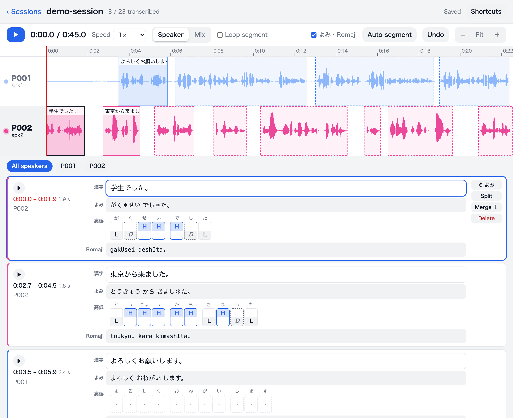
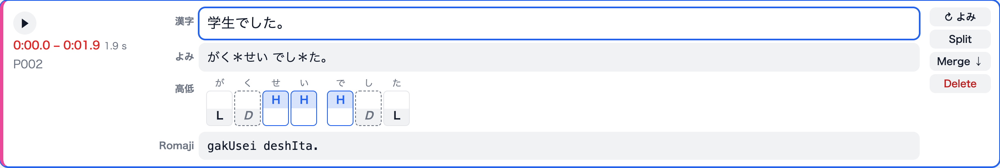

# ipad-multitalker-recorder

A self-hosted web app that records several iPads at the same time and keeps them in sync. Each iPad opens a
web page and records raw audio; one admin phone or laptop starts and stops everything. Everything stays on
your own machine.

- **Record**: raw 24-bit audio per iPad (echo cancellation, noise suppression and auto-gain are off),
  uploaded live to your laptop, with a local retry if Wi-Fi drops.
- **Control**: one admin page shows every device's state and level, assigns positions and IDs, and starts and
  stops with a slide gesture.
- **Sync**: the admin device plays a chirp at the start and end of each session. Afterwards the tracks are aligned
  to the sample and each iPad's clock drift is corrected.
- **Optional labels**: a distraction-free participant screen where people tap an emotion while they speak.
- **Tools**: align and merge tracks, draft speech and overlap regions, attach labels to speech segments.
<<<<<<< HEAD
- **Optional AI participant**: include a voice AI (ChatGPT, Gemini Live or any other) in the conversation
  and record its voice and what it said on the same timeline.
=======
- **Transcribe**: a browser page with a playable waveform per speaker, where you type what was said in
  three scripts (漢字, よみがな, romaji) and mark the pitch accent of every mora.
>>>>>>> main

| Mode | Hardware | Output |
|---|---|---|
| **A** | 1 iPad + 4-channel lavalier receiver | `lav.wav` |
| **B** | Any number of iPads (e.g. one per speaker) + optional iPad in the center | one aligned WAV per device, named after its device name |

The number of devices is not fixed. Each iPad gets a **device name** you type (or pick from the quick chips S1–S4,
Center, Lav). Names are free text (letters, digits, `-`, `_`) and become the file names, so `spk1`, `alice` or
`table-left` all work. `center` and `lav` are treated as room/receiver mics, `ai` (or `ai2`, `ai-gemini`, …) as
the AI agent's track, and every other name is a speaker iPad.

## Requirements

- A laptop on the same Wi-Fi as the iPads. macOS is assumed by `make_cert.sh`; on Linux, create the
  certificate with `mkcert` yourself and put `cert.pem` / `key.pem` in `certs/`.
- Python 3 (developed with 3.14) and [mkcert](https://github.com/FiloSottile/mkcert).
- iPads running iPadOS 14.5 or newer (Safari needs AudioWorklet).

## Setup (laptop)

```bash
brew install mkcert
python3 -m venv .venv && .venv/bin/pip install -r requirements.txt
./make_cert.sh            # run again if the laptop's Wi-Fi IP changes
.venv/bin/python server.py
```

The server prints three URLs. Every device (iPads and the admin device) must be on the same Wi-Fi.
Use `--out <folder>` to store recordings somewhere other than `recordings/`.

## Setup (each iPad and the admin device)

Safari only allows the microphone over trusted HTTPS, so each device must trust the laptop's certificate:

1. Open `http://<laptop-ip>:8080/` and tap **Download rootCA.pem**.
2. Settings → General → VPN & Device Management → install the profile.
3. Settings → General → About → Certificate Trust Settings → turn on full trust.
4. On the iPads, set Settings → Display & Brightness → **Auto-Lock → Never**, and turn on
   Settings → Accessibility → **Guided Access** so the page can't be left by accident.

## Running a session

1. On each iPad, open `https://<laptop-ip>:8443/record`, type a device name (or tap a quick chip: S1–S4, Center, Lav),
   tap **Arm microphone** and allow mic access. Then triple-click the Home button to start Guided Access.
2. On the admin device (a phone or a Mac), open `https://<laptop-ip>:8443/control`. The big status shows
   whether everything is ready ("Ready", or "N to fix" with the reasons underneath).
   - **Tap a device row** to expand it: device name, participant ID, label language, participant view,
     Identify (flashes that iPad's screen). A coloured dot and a few flags show its state; a flag only
     appears when something is wrong.
   - **Mics toward participant** (Speaker iPads card) is optional. The iPad's microphone is on its top edge, so with
     it on, every speaker iPad asks the participant to tap **Start** (allow motion access once) and turn the iPad
     around. A live drawing follows the turn and shows a green ✓ when the mic edge faces them, then the screen
     flips 180° so it reads upright. Flat on a table it uses the compass, held upright the screen rotation; if
     neither works the participant turns it by hand and taps **Done**. The admin page shows "not turned" or
     "✓ turned" per iPad, and **Flip screen** on the iPad undoes the flip if it looks wrong.
   - **Disarm** (in the expanded row, or **Disarm all** in the Speaker iPads card) releases an iPad's microphone
     between sessions. It is disabled while recording.
   - **Swipe an offline device left** to remove it (or use Remove in its expanded row).
3. **Slide to start** (drag the handle all the way right). About 1.5 s later the admin device plays the
   **sync chirp**: hold it near the middle of the table, with media volume at about 70%.
   While recording, **♪ Chirp** plays an extra chirp and **⚑ Marker** adds a marker (tap) or a labelled
   marker (hold).
4. **Slide to stop**. The admin device plays an end chirp, then every iPad uploads what is left.
   Wait for "Session saved".

If a banner appears at the top of the admin page, an iPad is running an old copy of the page or the server
needs a restart after a code change: reload that iPad's page (close the tab if needed) or restart
`python server.py`.

Each device needs a unique name when a session starts; any number of armed devices can record at once.

Each session is saved in `recordings/<date>_<name>/`: one WAV per device plus `session.json` (devices,
participant IDs, chirp and marker times, interruptions, labels).

## Updates

If you installed with `git clone`, the server checks GitHub every 6 hours for new commits on `main`. When there
are any, it prints a notice in the terminal and shows a banner on the admin page. Update with `git pull` and
restart the server. It only reads the public GitHub API and sends nothing about your setup. Use
`--no-update-check` to turn it off, or `--repo owner/name --branch name` if you run a fork. A downloaded zip
(no `.git` folder) can't check for updates.

## Participant view and labels (optional)

Each speaker iPad can switch to a **participant view**: a simple screen with eight emotion buttons (Neutral,
Happy, Sad, Angry, Surprised, Fear, Disgust, Contempt), a recording timer, a level bar and a status chip.
No device settings are shown. The layout adapts to the orientation (4 × 2 in landscape, 2 × 4 in portrait).

- Switch it from the admin device (**Speaker iPads → Participant view**, or per device), or tap
  **Participant view** on the iPad. The **‹** button returns to setup; it never stops a recording.
- A participant taps the emotion that matches how they feel while speaking. It stays selected until they tap
  another one, and every recording starts with the selected emotion.
- Labels can be shown in Japanese or English (the **日本語 | English** switch decides which label is big). The
  admin device can set it for all speaker iPads or per device. The buttons are defined in
  `static/emotions.js` (edit labels or add and remove emotions).

Labels are saved per device in `session.json` as an emotion plus an audio frame position.

## AI agent in the conversation (optional)

A voice AI can take part in the conversation as one more participant. Pick how it joins under **AI agent** on
the admin page before you slide to start. Each option records its audio as the device `ai`, so it is aligned
like every other track.

| Option | The AI runs on | What is recorded | AI text | Works with |
|---|---|---|---|---|
| **Room** | its own app on a phone or speaker at the table | an iPad named `ai` next to its speaker (room sound) | transcribed afterwards | any agent |
| **Laptop** | the laptop (browser or desktop app) | the laptop's sound output, digitally, plus the laptop mic | transcribed afterwards | any agent with a web or desktop app |
| **API** | this server, which talks to the AI service | exactly what the AI said, plus the iPad's mic | from the AI service, word for word | OpenAI Realtime, Gemini Live (more via `ai_bridge/`) |

Type which agent and version you use (e.g. "ChatGPT voice, app 1.2025.xxx") in the box that appears. It is
saved in `session.json`.

**Room**: start the agent's own voice mode (ChatGPT, Gemini Live, …) on a phone or tablet in the middle of the
table, with the volume fixed. Put an iPad named **AI** (quick chip) 20–30 cm from its speaker and arm it as
usual. Nothing else is needed. The AI track also picks up the people nearby, and the consumer app applies its
own echo cancellation and turn-taking, which you can't control.

**Laptop**: the AI's sound is taken before it reaches the speaker, so the AI track has no room noise.
1. Install [BlackHole 2ch](https://github.com/ExistentialAudio/BlackHole) and the extras:
   `.venv/bin/pip install -r requirements-ai.txt`.
2. Audio MIDI Setup → **+** → *Create Multi-Output Device* with your speakers + BlackHole 2ch. Make it the
   system output, so you still hear the AI and BlackHole gets a copy.
3. Audio MIDI Setup → **+** → *Create Aggregate Device* with BlackHole 2ch + the built-in microphone (tick *Drift
   Correction* on the mic). Inputs 1–2 are then BlackHole and input 3 is the mic.
4. With `server.py` running, in a second terminal:
   ```bash
   .venv/bin/python -m tools.loopback --list
   .venv/bin/python -m tools.loopback --device "Aggregate Device" --ai-ch 1,2 --mic-ch 3
   ```
   It appears on the admin page as `ai` (*laptop loopback*) and starts and stops with every session.
5. Open the agent (chatgpt.com voice mode, gemini.google.com Live, a desktop app, …) on the laptop and let it
   use the laptop mic, or a mic in the middle of the table. Keep the laptop near the admin device so its mic
   hears the sync chirp.

**API**: the server connects to the AI service itself. An iPad named **AI** is the AI's mouth and ear: it
plays the AI's voice through its speaker and sends its mic to the AI. It records two channels: its mic, and the
exact audio it played, sample for sample. You get a clean AI track, the AI's own transcript of every turn, and
what it understood the participants said.
1. Get an API key and set it in the terminal that runs the server, then start it:
   ```bash
   export OPENAI_API_KEY=sk-...      # ChatGPT voice (OpenAI Realtime API)
   export GEMINI_API_KEY=...         # Gemini Live (Google AI Studio)
   .venv/bin/python server.py
   ```
   API use is billed per minute of audio to that key.
2. Choose the model, voice and the AI's instructions (its system prompt) in `ai_agents.json`. The instructions
   and settings are saved in `session.json` for each session. Model names change over time, so check the
   provider's docs if a connection fails.
3. On the admin page choose **AI agent → API** and the provider. The **AI agent** card shows what the AI is
   doing, its last sentence and what it heard. **Mute** stops it hearing the room, and **Interrupt AI** cuts it off.
   Both are logged.
4. While the AI talks, the iPad sends silence to the AI so it doesn't hear itself through its own speaker.
   As a result, people cannot interrupt it by talking (use **Interrupt AI**). Set `"barge_in": true` in
   `ai_agents.json` to let people talk over it. That only works well with good echo handling, e.g. headphones on
   the AI iPad's output or a speaker some distance from the AI iPad.

To support another realtime voice API, add an adapter to `ai_bridge/` (see `ai_bridge/base.py`). Any agent
without an API can still join with **Room** or **Laptop**.

**Results** (after `tools.align`): `aligned/ai.wav` is the AI's voice. For Laptop and API it is the clean
digital channel, and the mic is kept as `aligned/ai_mic.wav`. `align` measures the delay between the
played sound and the mic (typically 10–60 ms) and removes it. `draft_rttm` labels the AI as speaker `AI`, so
`overlap.tsv` includes people talking over the AI. Then:

```bash
.venv/bin/python -m tools.ai_transcript recordings/<session>   # what the AI said (and heard), when
```

writes `aligned/ai_turns.tsv` (`role, start_s, end_s, text, source`). With API it uses the service's own
transcripts and the exact moments each turn was played. With Room/Laptop it transcribes `ai.wav` with
faster-whisper (`--whisper small|medium|large-v3`, `--language ja`). The API scenario also writes every event
the service sent to `recordings/<session>/ai_events.jsonl`.

## Post-processing

```bash
.venv/bin/python -m tools.align      recordings/<session>   # align tracks, correct clock drift
.venv/bin/python -m tools.draft_rttm recordings/<session>   # draft speech + overlap regions
.venv/bin/python -m tools.utterances recordings/<session>   # attach labels to speech segments
.venv/bin/python -m tools.ai_transcript recordings/<session> # only with an AI agent: its turns + text
```

- **`align`** finds the start and end chirp in every track, corrects each iPad's clock drift (typically
  ±10–60 ppm, which grows to 100+ ms per hour) and shifts all tracks onto one timeline. It writes
  `aligned/*.wav`, `alignment.json`, `markers.tsv` and `emotions.tsv` (labels on the aligned timeline), and
  merges the speaker tracks into `aligned/combined.wav` (one channel per iPad, order in `combined.json`) and
  `aligned/mix_mono.wav`. Use `python -m tools.combine recordings/<session> --devices spk1,alice,center` to pick
  the channels. If a chirp is missing it warns, and that track falls back to network timestamps (accurate to
  roughly 20–100 ms).
- **`draft_rttm`** compares the close-talk channels' energy to produce `aligned/draft.rttm`, rejecting crosstalk
  and keeping real overlaps. It reports overlap as a share of speech time and lists each region in
  `aligned/overlap.tsv` (`--min-overlap` sets the minimum length, default 0.1 s). Treat it as a starting point
  for manual correction, not ground truth.
- **`utterances`** cuts each speech segment where the selected emotion changed and writes
  `aligned/utterances.tsv` (`speaker, device, start_s, end_s, dur_s, emotion`). Pass your own corrected segments
  with `--rttm yours.rttm`; `--shift 0.5` moves emotion changes 0.5 s earlier; `--min-piece` merges slivers.

If the server crashed mid-session, rebuild the WAVs from the raw files with
`python -m tools.common recordings/<session>`.

## Transcribing

A browser page for writing down what each speaker said, next to a playable waveform of their own microphone.



### Starting it from the command line

```bash
.venv/bin/python -m tools.annotate recordings/<session>    # open one session
.venv/bin/python -m tools.annotate                         # list the sessions in recordings/ and pick one
.venv/bin/python -m tools.annotate /path/to/sessions       # the same, for sessions kept in another folder
```

The command prints the address, opens it in your browser (`http://127.0.0.1:8765/annotate`) and keeps
running until you press Ctrl+C. It runs on the laptop only and needs no certificate and no iPads.

| Option | What it does |
|---|---|
| `--port 9000` | use another port (default 8765), for example when 8765 is already in use |
| `--no-open` | do not open the browser; open the printed address yourself |

For a session with several devices, align it first so that every speaker is on the same timeline and
Auto-segment can tell the speakers apart:

```bash
.venv/bin/python -m tools.align      recordings/<session>
.venv/bin/python -m tools.draft_rttm recordings/<session>
.venv/bin/python -m tools.annotate   recordings/<session>
```

The よみ and romaji drafts need the `fugashi` and `unidic-lite` packages (about 250 MB). They are in
`requirements.txt`; if your `.venv` is older than this page, run `.venv/bin/pip install -r requirements.txt`
again. Without them the page still works and you type the よみ yourself.

While the recording server is running you do not need the command: the same page is at
`https://<laptop-ip>:8443/annotate`, and the start page has a **Transcribe** button.

### The four lines

The page shows one waveform per device and, below it, the list of speech segments. Each segment has four
lines:



| Line | What goes in it | Example |
|---|---|---|
| **漢字** | what was said, as normally written | 学生でした。 |
| **よみ** | the reading in hiragana, with a space between words; `＊` after a mora marks a devoiced vowel | がく＊せい でし＊た。 |
| **高低** | pitch accent, one box per mora of the よみ: `L` low, `H` high, `D` devoiced (and low) | `LDHH HDL` |
| **Romaji** | Hepburn, long vowels spelled out; a devoiced vowel is a capital | gakUsei deshIta. |

You only type the first line. When you leave it, the よみ and romaji lines are drafted for you, and you
correct them where the reading is wrong (names and words like 私 or 日本 are common cases). A line you
corrected by hand is not overwritten when you edit the text again; **↻ よみ** rewrites both lines on purpose.
Correcting the よみ line updates the romaji. A line gets an orange edge when something is left over in it
(kanji or digits in the よみ, non-Latin characters in the romaji). Switch **よみ・Romaji** off in the toolbar to
type plain text only, for example for English.

The pitch line is filled in by hand. It always has exactly as many boxes as the よみ has morae (きょ, ん, っ and
ー each count as one). Click a box to step through L → H → D, or put the cursor in the line and type the
letters one after another (`LHHLL…`); ← and → move between morae. High boxes sit high and low boxes sit low,
so the line reads as the pitch contour. When you edit the よみ, the morae that did not change keep their
marks and new ones start empty (saved as `_`).

Devoicing is one fact written three ways, and the page keeps them in step: `＊` in the よみ, `D` in the pitch
line, a capital vowel in the romaji. Set any one of them and the other two follow, as long as the romaji is
still the automatic draft.

### Working through a session

1. **Auto-segment** marks the speech in every track that has no segments yet. It uses `aligned/utterances.tsv`
   if you ran `tools.utterances`, else `aligned/draft.rttm`, else the pauses in each track. For several
   speakers, run `tools.align` and `tools.draft_rttm` first: pauses alone cannot tell a speaker from the
   neighbour's voice in their microphone.
2. Fix the segments on the waveform: drag an edge to move it, drag on empty space to add one, and use
   **Split**, **Merge ↓** and **Delete** in the list. **Undo** takes back any of these.
3. Type. **Enter** goes to the next segment and plays it, **Esc** pauses or replays the current one. The
   **Shortcuts** button lists the rest.

With several devices, clicking a segment plays that speaker's own microphone; **Mix** plays everyone.

### Emotions

Every segment has one emotion. It starts as the emotion the speaker had tapped during most of the segment
while recording, or Neutral when nothing was tapped, and you can change it:

- pick another one from the list in the segment's row, or
- select the segment and press **1** to **8** (the order of the list, which is the order in
  `static/emotions.js`).

On the waveform a segment is drawn in the colour of its emotion from its start to its end: a solid span with
the emotion's name in the band above the waveform, and a lighter fill over the waveform itself. When the
emotion changes inside a segment, **Split** it there and set the two halves.

What the participant tapped is never rewritten. It stays in `session.json` (and `aligned/emotions.tsv`) and
shows as a thin strip along the bottom of the lane, so you can compare it with the labels you set.

### What it saves

Everything is saved as you type, in `aligned/` if the session is aligned and in the session folder otherwise:

- `transcript.tsv`: `speaker, device, start_s, end_s, dur_s, emotion, text, kana, pitch, romaji`. The columns
  of `utterances.tsv` plus the four lines; `emotion` is the segment's emotion as set on the page. `pitch` has
  one letter per mora, grouped like the words in `kana`.
- `transcript.json`: the same segments, which the page loads again next time.

Align a session before you transcribe it. A transcript made on the unaligned tracks stays in the session
folder and is not moved onto the aligned timeline.

To see the drafted よみ and romaji for a sentence without opening the page:

```bash
.venv/bin/python -m tools.reading "今日は東京へ行きます。"
# きょう は とうきょう へ いきます。
# kyou wa toukyou e ikimasu.
```

## Project layout

```
server.py        FastAPI + WebSocket server: receives audio, runs sessions
<<<<<<< HEAD
static/          recorder page (/record), admin page (/control), shared assets
tools/           post-processing: align, combine, draft_rttm, utterances, ai_transcript;
                 loopback.py records an AI agent running on the laptop
ai_bridge/       AI agent API bridge (OpenAI Realtime, Gemini Live adapters)
ai_agents.json   AI agent models, voices and instructions
=======
static/          recorder page (/record), admin page (/control), transcription page (/annotate), shared assets
tools/           post-processing: align, combine, draft_rttm, utterances;
                 transcription: annotate (page backend), reading (よみがな and romaji drafts)
docs/            screenshots used in this README
>>>>>>> main
make_cert.sh     local HTTPS certificate for the laptop's IP
```

## Known limits

- **Multichannel input (mode A):** Safari on iPad usually delivers only **mono** from external interfaces. If the
  receiver mixes its mics down to one output you get one mixed track, and `draft_rttm` cannot split speakers
  from it. To keep separate channels, record them with a native multitrack app (or on the receiver itself) and
  play a chirp at the start and end so `align` can still sync them.
- The 7th-gen iPad has a Lightning port: a USB receiver needs the powered *Lightning to USB 3 Camera Adapter*.
- If Safari goes to the background (Home button, a tapped notification, a call), audio stops. The page fills
  the gap with silence and logs it in `session.json`. Guided Access prevents this.
- Uploads are acknowledged chunk by chunk, so a Wi-Fi drop only delays them as long as the recorder page stays
  open. Reloading an iPad's page during a recording loses that iPad's take.

## Tips

- Get consent from everyone you record. `recordings/` and `certs/` are git-ignored; never commit them.
- Keep the speaker iPads at about the same distance from their speakers (30–50 cm, facing them) so
  loudness-based tools stay comparable.
